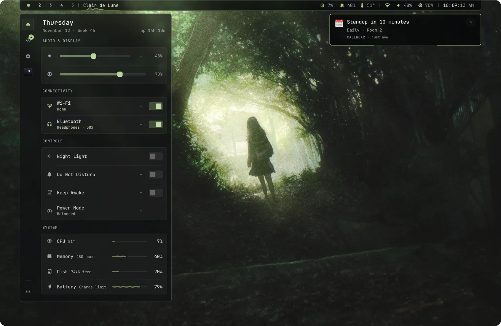
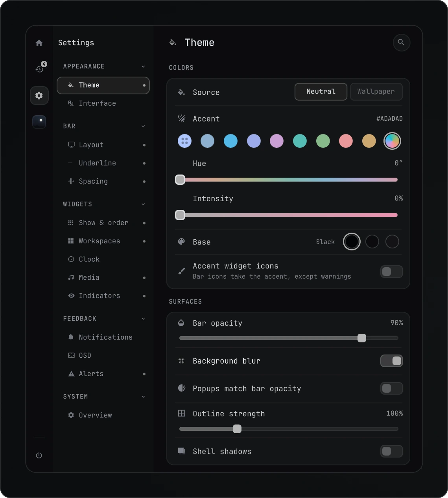

<p align="center">
  <picture>
    <source media="(prefers-color-scheme: light)" srcset="assets/banner-light.svg"/>
    
  </picture>
</p>

<p align="center">
  <a href="https://github.com/s3rven/silere-shell/releases"></a>
  <a href="https://github.com/s3rven/silere-shell/actions/workflows/validate.yml"></a>
  <a href="LICENSE"></a>
</p>

<p align="center">
  A desktop shell for <b>Hyprland</b> and <b>niri</b>, built on
  <a href="https://quickshell.org/">Quickshell</a>.
</p>

<p align="center">
  
</p>

Silere is the bar, notifications, tray and quick settings I use on my own desktop. It runs as one
process and replaces Waybar and a notification daemon such as mako or dunst. Your compositor
config, launcher, wallpaper tool and lock screen stay your own.

## What's included

| Feature | What you get |
|---|---|
| Bar | Workspaces with app icons, window title, media, system readings, tray, and a clock with a calendar and optional weather. Choose the widgets and their order. |
| Quick settings | Output, microphone and per-app volume; brightness; Wi-Fi, Bluetooth and VPN; power mode, Night Light and Keep Awake; battery health and charge limit. |
| Notifications | Actions, inline replies, conversation grouping, searchable history, app muting and Do Not Disturb. |
| Media | Album art, seeking, player switching and an optional Cava visualizer. |
| On-screen display | Volume, brightness, power mode changes and battery warnings, floating or inside the bar. |
| Appearance | Wallpaper colours through Matugen, dark and light modes, a custom accent and adjustable interface size. |
| Updates | Signed releases from the menu, validation before installation and rollback to the previous version. |

## A closer look

<p align="center">
  
  <br/><sub>Colours follow your wallpaper through Matugen, in dark or light mode.</sub>
</p>

<p align="center">
  
  <br/><sub>Now Playing with cover art and seeking, the calendar with week numbers, and a notification with actions.</sub>
</p>

<p align="center">
  
  <br/><sub>Settings apply as you change them, and Ctrl+F finds any option.</sub>
</p>

## Getting started

You need **Hyprland or niri** and **Quickshell 0.3.1 or newer** built against **at least Qt 6.10**.
On Hyprland 0.57, use Quickshell 0.3.2 for
[named and special workspaces](docs/troubleshooting.md#special-or-named-workspaces-misbehave-after-a-hyprland-update).
On Arch Linux:

```bash
sudo pacman -S --needed quickshell git curl ttf-jetbrains-mono-nerd
```

Other distributions follow [Quickshell's install guide](https://quickshell.org/docs/v0.3.1/guide/install-setup/).
Icons need a Nerd Font, which the installer can download ([fonts](docs/install.md#fonts)).

**Try it in a window first.** The preview uses its own session and temporary settings, and needs
`dbus-run-session` and `setsid`. Its audio, network and Bluetooth controls act on your real devices.

```bash
git clone --depth 1 https://github.com/s3rven/silere-shell
cd silere-shell
bash scripts/silere try    # Alt + / opens the preview's menu; close the window to end it
```

**Then install** as your normal user, after stopping your current bar and notification daemon:

```bash
bash scripts/install.sh    # from the clone, or without one:
curl -fsSL https://raw.githubusercontent.com/s3rven/silere-shell/main/scripts/install.sh | bash
```

The installer checks dependencies, installs to `~/.config/silere-shell`, and offers autostart and a
`silere` command. It asks before editing your compositor config and backs up what it changes. The
[installation guide](docs/install.md) covers dry runs, custom directories and crash recovery.

## Getting around

| To open | Do this |
|---|---|
| Menu | Click the active workspace, or press **Super + /** once the installer adds it |
| Quick actions | Right-click the active workspace |
| Calendar | Click the clock |
| Now Playing | Right-click the media widget |
| Settings | Open the menu and choose **Settings**; **Ctrl+F** finds any option |

Tab, Enter and the arrow keys work in every panel, and Escape steps back, then closes the panel.
Any keybind can run `silere ipc menu toggle`. The [usage guide](docs/usage.md) lists every click,
scroll and shortcut, and the [scripting guide](docs/scripting.md) covers IPC and hooks.

Settings apply as you change them. Only values that differ from the defaults are saved, in
`~/.config/silere-shell/settings.json`. Colours can follow your wallpaper through
[Matugen](docs/install.md#matugen). [Settings and resets](docs/usage.md#settings) has the details.

## Useful commands

| Command | What it does |
|---|---|
| `silere run` | Start the shell |
| `silere stop` | Stop the shell, including its optional user service |
| `silere restart` | Restart the shell |
| `silere status` | Show the running checkout and update state |
| `silere doctor` | Check the setup without changing it |
| `silere log --follow` | Follow the running shell's log |
| `silere update` | Check for a signed release |
| `silere update --apply` | Validate and install the release |
| `silere update --rollback` | Restore the version an update replaced |
| `silere reset` | Preview a reset of settings, local edits and caches |
| `silere uninstall` | Remove the installer's integrations and keep your settings |

`silere help` lists the rest. [Updates and recovery](docs/updates.md) covers automatic checks and
local edits.

## Other desktop tools

Silere leaves these jobs to other programs. None are required; these are the ones I use.

| For | I use |
|---|---|
| Launcher, clipboard history, file search and window switching | [Vicinae](https://github.com/vicinaehq/vicinae) |
| Wallpaper | [awww](https://codeberg.org/LGFae/awww) |
| Colours from the wallpaper | [Matugen](https://github.com/InioX/matugen) |
| Lock screen and idle | [hyprlock](https://github.com/hyprwm/hyprlock) and [hypridle](https://github.com/hyprwm/hypridle) |
| Night light | [hyprsunset](https://github.com/hyprwm/hyprsunset) on Hyprland; [wlsunset](docs/troubleshooting.md#night-light-is-unavailable-on-niri) on niri |
| Screenshots | [grim](https://gitlab.freedesktop.org/emersion/grim), [slurp](https://github.com/emersion/slurp) and [Satty](https://github.com/gabm/Satty) |
| Audio visualizer | [Cava](https://github.com/karlstav/cava) |

Settings lists any helper a control is missing. The [optional tools](docs/install.md#optional-tools)
table names the packages.

## Under the hood

Animations and system readings pause when the session goes idle, and the visualizer, network
speed, clock seconds and underline effects start switched off. Measured with
[`scripts/bench.sh`](docs/performance.md) on 1.7.0, visualizer off, with one
[allocator pool](docs/performance.md#memory-allocator) as `silere run` starts it:

| Machine | Memory after startup | After one menu open | Idle CPU |
|---|---|---|---|
| Ryzen 7 8845HS laptop, 2560x1600 | 106 MB | 115 MB | under 1% of one core |
| 2015 laptop: Core i5-6200U, Intel HD 520, 1920x1080 | 106 MB | 121 MB | under 1% of one core |

Memory is PSS and depends on the machine, fonts, widgets and allocator tuning. The
[performance guide](docs/performance.md) explains the numbers and how to measure your own.

Tests cover service logic, keyboard and pointer input, layout fit and display scaling, plus hung
tools and malformed notifications, media and tray items. CI runs them on every push in KWin and
niri sessions, at 125% and 150% scale, against Quickshell 0.3.1 and the current release. CI
runners have no GPU, so the Hyprland session tests run on my machine with every change. See the
[testing guide](docs/testing.md).

## When something's wrong

Run `silere doctor`, then read the [troubleshooting guide](docs/troubleshooting.md). A bug report
needs the output of `silere version`, the steps to reproduce it and the errors;
[reporting a problem](docs/troubleshooting.md#reporting-a-problem) explains where the logs are.

[Ask a question](https://github.com/s3rven/silere-shell/discussions) · [Report a bug](https://github.com/s3rven/silere-shell/issues/new?template=bug_report.yml)

## Contributing

Fixes, ideas and documentation changes are welcome. The [contributing guide](CONTRIBUTING.md)
has the checks and commit conventions, and the [code guide](docs/forking.md) the project layout.
I test on Hyprland laptops, so reports from niri, several monitors or NVIDIA help the most.

If you use Silere, tell me how it's going in
[this thread](https://github.com/s3rven/silere-shell/discussions/3), good or bad.

### On AI assistance

I use AI tools while building Silere. I review the changes and use the shell on my own desktop.
AI-assisted contributions are welcome too.

[MIT](LICENSE) © s3rven
