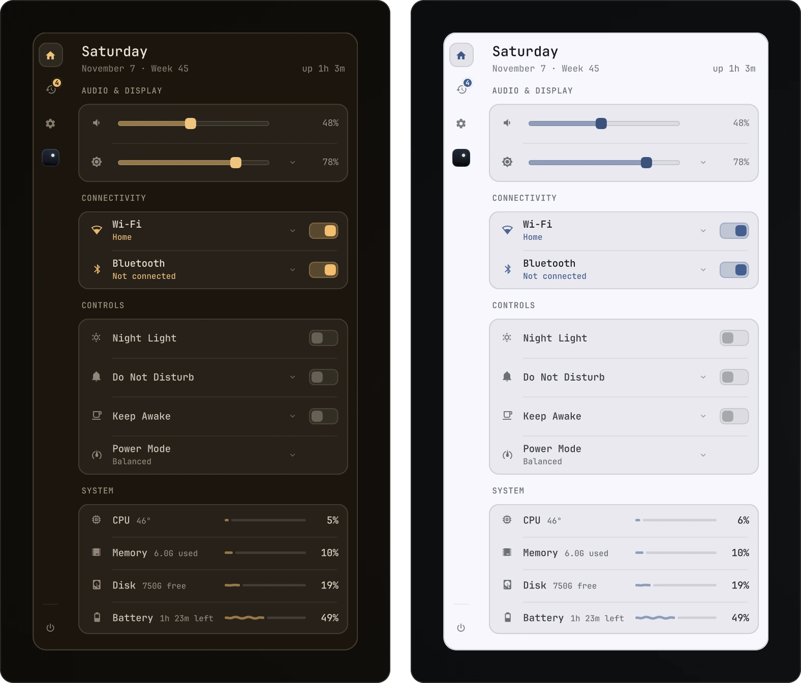

<p align="center">
  <picture>
    <source media="(prefers-color-scheme: light)" srcset="assets/banner-light.svg"/>
    
  </picture>
</p>

<p align="center">
  <a href="https://github.com/s3rven/silere-shell/releases"></a>
  <a href="https://github.com/s3rven/silere-shell/actions/workflows/validate.yml"></a>
  <a href="LICENSE"></a>
</p>

<p align="center">
  A desktop shell for <b>Hyprland</b> and <b>niri</b>, built on
  <a href="https://quickshell.org/">Quickshell</a>.
</p>

<p align="center">
  <a href="#getting-started">Install or try</a> ·
  <a href="docs/usage.md">Everyday use</a> ·
  <a href="docs/troubleshooting.md">Troubleshooting</a> ·
  <a href="docs/README.md">All docs</a>
</p>

<p align="center">
  
</p>

Silere is the bar, notifications, tray and quick settings I use on my own desktop. It runs as one
process and replaces Waybar and a notification daemon such as mako or dunst. Your compositor
config, launcher, wallpaper tool and lock screen stay your own.

## What's included

| Feature | What you get |
|---|---|
| Bar | Workspaces with app icons, window title, media, system readings, tray, and a clock with a calendar and optional weather. A Command widget shows a script's output, Waybar custom modules included. Choose the widgets and their order. |
| Quick settings | Output, microphone and per-app volume; brightness, external monitors included over DDC/CI; Wi-Fi, Bluetooth and VPN; power mode, Night Light and Keep Awake; battery health and charge limit. |
| Notifications | Actions, inline replies, conversation grouping, searchable history, app muting and Do Not Disturb. |
| Media | Album art, seeking, player switching and an optional Cava visualizer. |
| On-screen display | Volume, brightness, power mode changes and battery warnings, floating or inside the bar. |
| Appearance | Wallpaper colours through Matugen, dark and light modes, a custom accent and adjustable interface size. |
| Updates | Signed releases from the menu, validation before installation and rollback to the previous version. |

## Getting started

You need **Hyprland or niri** and **Quickshell 0.3.1 or newer** built against **at least Qt 6.10**.
On Hyprland 0.57, use Quickshell 0.3.2 for
[named and special workspaces](docs/troubleshooting.md#special-or-named-workspaces-misbehave-after-a-hyprland-update).
On Arch Linux:

```bash
sudo pacman -S --needed quickshell git curl ttf-jetbrains-mono-nerd
```

Other distributions follow [Quickshell's install guide](https://quickshell.org/docs/v0.3.1/guide/install-setup/).
Icons need a Nerd Font, which the installer can download ([fonts](docs/install.md#fonts)).

**Try it in a window.** The preview uses its own session and temporary settings. It needs
`dbus-run-session` and `setsid`. Audio, network and Bluetooth controls act on your real devices.

```bash
git clone --depth 1 https://github.com/s3rven/silere-shell
cd silere-shell
bash scripts/silere try    # Alt + / opens the preview's menu; close the window to end it
```

**Install as your normal user.** Run `bash scripts/install.sh` from the clone, or use the
one-line installer:

```bash
curl -fsSL https://raw.githubusercontent.com/s3rven/silere-shell/main/scripts/install.sh | bash
```

The installer checks dependencies, installs to `~/.config/silere-shell` by default, and offers
autostart and a `silere` command. It asks before editing your compositor config and backs up what it
changes. Stop your current bar and notification daemon before starting Silere with `silere run`;
the installer names the lines in your config that start them at login.
See the [installation guide](docs/install.md) for first start, custom paths and crash recovery.

## Getting around

| To open | Do this |
|---|---|
| Menu | Click the active workspace, or use **Super + /** if you accepted the Hyprland shortcut |
| Quick actions | Right-click the active workspace |
| Calendar | Click the clock |
| Now Playing | Right-click the media widget |
| Settings | Open the menu and choose **Settings**. Press **Ctrl+F** to search. |

Use **Tab** to move between controls, **Enter** to activate them, and **Esc** to step back or close.
The [usage guide](docs/usage.md#keyboard) lists the keyboard shortcuts. Bind commands like
`silere menu`, `silere toggle dnd` or `silere volume up` in your compositor; on Hyprland,
**Settings › System › Keybinds** lists your shortcuts and copies Silere's. See the
[scripting guide](docs/scripting.md) for keybinds, IPC, hooks and the [Command widget](docs/scripting.md#command-widget).

Settings apply as you change them. Saved overrides live in `~/.config/silere-shell/settings.json`
by default. For multiple monitors, use **Settings › System › Devices** to choose which screens
show the bar, where popups appear and which monitors join the bar's brightness scroll.
[Display settings](docs/usage.md#displays) · [External brightness setup](docs/troubleshooting.md#external-monitor-brightness-is-missing-or-does-not-respond)

## Useful commands

| Command | What it does |
|---|---|
| `silere run` | Start the shell |
| `silere stop` / `silere restart` | Stop or restart the shell |
| `silere status` | Show the running checkout and update state |
| `silere doctor` | Check the setup without changing it |
| `silere log --follow` | Follow the running shell's log |
| `silere update` | Check for a signed release |

`silere help` lists the rest. [Updates and recovery](docs/updates.md) covers installing and rolling
back releases. The [installation guide](docs/install.md#maintenance-command) covers resets and
uninstalling.

## A closer look

<p align="center">
  
</p>

<p align="center">
  
</p>

<p align="center">
  
</p>

## Other desktop tools

Silere leaves these jobs to other programs. None are required; these are the ones I use.

| For | I use |
|---|---|
| Launcher, clipboard history, file search and window switching | [Vicinae](https://github.com/vicinaehq/vicinae) |
| Wallpaper | [awww](https://codeberg.org/LGFae/awww) |
| Colours from the wallpaper | [Matugen](https://github.com/InioX/matugen) |
| Lock screen and idle | [hyprlock](https://github.com/hyprwm/hyprlock) and [hypridle](https://github.com/hyprwm/hypridle) |
| Night light | [hyprsunset](https://github.com/hyprwm/hyprsunset) on Hyprland; [wlsunset](docs/troubleshooting.md#night-light-is-unavailable-on-niri) on niri |
| Screenshots | [grim](https://gitlab.freedesktop.org/emersion/grim), [slurp](https://github.com/emersion/slurp) and [Satty](https://github.com/gabm/Satty) |
| Audio visualizer | [Cava](https://github.com/karlstav/cava) |

Settings lists any helper a control is missing. The [optional tools](docs/install.md#optional-tools)
table names the packages.

## Under the hood

Animations and system readings pause when the session goes idle. The 1.8.0 release measured
107 MB PSS after startup and 108 MB after opening and closing the menu once on the Ryzen 7
8845HS reference laptop. See the [performance guide](docs/performance.md) for the conditions and
how to measure your setup.

CI checks the minimum Quickshell runtime, runs layout and input probes at 125% and 150% scale,
and exercises nested compositor sessions where the runner supports them. The
[testing guide](docs/testing.md#what-ci-runs) lists the jobs and GPU requirements.

## When something's wrong

Run `silere doctor`, then read the [troubleshooting guide](docs/troubleshooting.md). A bug report
needs the output of `silere version`, the steps to reproduce it and the errors;
[reporting a problem](docs/troubleshooting.md#reporting-a-problem) explains where the logs are.

[Ask a question](https://github.com/s3rven/silere-shell/discussions) · [Report a bug](https://github.com/s3rven/silere-shell/issues/new?template=bug_report.yml)

## Contributing

Fixes, ideas and documentation changes are welcome. The [contributing guide](CONTRIBUTING.md)
has the checks and commit conventions, and the [code guide](docs/forking.md) the project layout.
I test on Hyprland laptops, so reports from niri, several monitors or NVIDIA help the most.

If you use Silere, tell me how it's going in
[this thread](https://github.com/s3rven/silere-shell/discussions/3), good or bad.

### On AI assistance

I use AI tools while building Silere. I review the changes and use the shell on my own desktop.
AI-assisted contributions are welcome too.

[MIT](LICENSE) © s3rven
