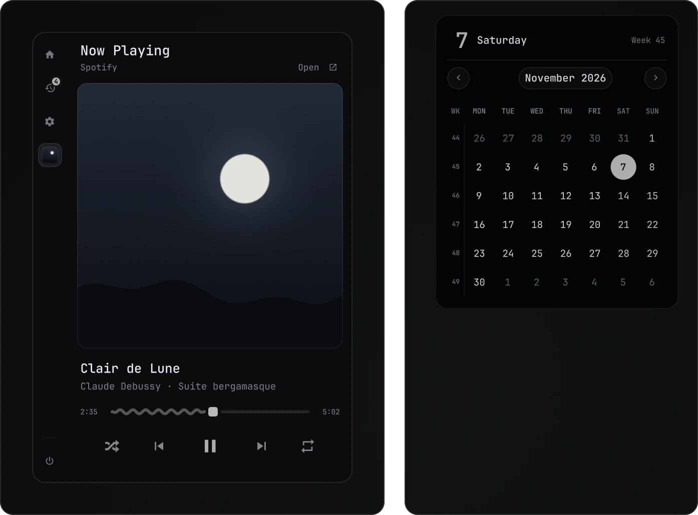

<p align="center">
  <picture>
    <source media="(prefers-color-scheme: light)" srcset="assets/banner-light.svg"/>
    
  </picture>
</p>

<p align="center">
  <a href="https://github.com/s3rven/silere-shell/releases"></a>
  <a href="https://github.com/s3rven/silere-shell/actions/workflows/validate.yml"></a>
  <a href="LICENSE"></a>
</p>

Silere is a desktop shell for Hyprland and niri, built with [Quickshell](https://quickshell.org/). One process
draws the bar, notifications, the on-screen display and a menu with quick settings, in place of Waybar and a
notification daemon such as mako or dunst. I use it every day on my own laptop.

<p align="center">
  
</p>

## What's included

- A bar with workspaces and their app icons, the window title, media with a visualizer, a system monitor, the
  tray, network, Bluetooth, volume, brightness, battery, and a clock with a calendar and weather, in the order
  you choose.
- Notifications with actions and inline replies, grouped conversations, a searchable history and scheduled Do
  Not Disturb. Popups wait during fullscreen games, calls and while you are away.
- A menu with per-app volume, brightness (external monitors too), Wi-Fi, Bluetooth, VPN, power mode, Night
  Light, battery health and charge limit, Now Playing and Settings.
- An on-screen display for volume, brightness and power mode, and alerts for a low battery, a hot CPU or a
  nearly full disk.
- Colours from your wallpaper through Matugen, or a neutral dark theme with your own accent.
- Signed updates with rollback, `silere doctor` for setup checks, and a preview that runs in a window.

Idle, it uses about 100 MB of memory and well under 1% of one core
([measured each release](docs/performance.md)).

<p align="center">
  
</p>

## Who it's for

Silere fits if you run Hyprland or niri and want the bar, notifications and quick settings from one program,
set up in its menu instead of config files. You bring the rest of the desktop: a launcher, a lock screen and
idle daemon, a wallpaper tool, and Matugen for colours from the wallpaper. [Companions](docs/companions.md)
shows how they connect. I run Silere on Hyprland; on niri it is tested in CI.

<p align="center">
  
</p>

## Install

You need Hyprland or niri and Quickshell 0.3.2 or newer, built against at least Qt 6.10. On Arch Linux:

```bash
sudo pacman -S --needed quickshell git curl ttf-jetbrains-mono-nerd
```

The [requirements](docs/install.md#requirements) name the packages for Debian, Ubuntu, Fedora and Void.

To try it first, run the preview. It opens Silere in a window with its own settings and leaves your desktop
alone; its sound, network and Bluetooth controls are live.

```bash
git clone --depth 1 https://github.com/s3rven/silere-shell
bash silere-shell/scripts/silere try    # Alt + / opens the menu; close the window to end it
```

To install, run `bash scripts/install.sh` from that clone, or:

```bash
curl -fsSL https://raw.githubusercontent.com/s3rven/silere-shell/main/scripts/install.sh | bash
```

The installer asks before it changes your compositor config and backs up each file it edits. It offers autostart
and, on Hyprland, Super + / for the menu, and names the lines that still start your old bar and notification
daemon. Stop those, then let it start Silere, or run `silere run` later. The
[installation guide](docs/install.md) has the details.

## First steps

| To open | Do this |
|---|---|
| Menu | Click the active workspace, or press Super + / if the installer bound it |
| Quick actions | Right-click the active workspace |
| Calendar | Click the clock |
| Notification history | Right-click the clock |
| Now Playing | Right-click the media widget |
| Settings | Open the menu and choose Settings; Ctrl+F searches |

Panels work from the keyboard too: Tab moves, Enter activates and Escape steps back, then closes. Settings
apply as you change them and are saved in `~/.config/silere-shell/settings.json`. With several monitors,
Settings › System › Devices picks which ones have a bar.

<p align="center">
  
</p>

`silere doctor` checks your setup without changing anything, `silere update` checks for a signed release, and
`silere help` lists the other commands. The [usage guide](docs/usage.md) covers the rest of the shell, and the
[scripting guide](docs/scripting.md) keybinds, hooks and IPC.

## Questions

### Does it have a launcher, a lock screen or a clipboard manager?

No. Use the ones you like and bind them in your compositor; [Companions](docs/companions.md) has examples, and
Silere's Lock action runs whichever locker you have. [Decisions](docs/decisions.md) explains why these stay out.

### Can I add my own widgets or plugins?

Not as plugins: Silere loads no outside code. A script can put a mark in the bar (`silere indicator`), show a
message in the OSD (`silere osd`), run on events through hooks, and change any setting.

### Does it run on GNOME, KDE, Sway or X11?

No. It needs Hyprland or niri on Wayland.

### What happens if an update breaks something?

`silere update --rollback` puts the previous release back, from a terminal even when the bar won't come up.
Updates are signed and tried in a sandbox before they replace anything. See
[updates and recovery](docs/updates.md).

### What else is left out on purpose?

A dock, a wallpaper picker, notification sounds, calendar accounts, an auto-hiding bar and a widget store.

## Getting help

Run `silere doctor`, then check the [troubleshooting guide](docs/troubleshooting.md). A bug report needs the
output of `silere version` and the steps to reproduce it.

[All docs](docs/README.md) · [Ask a question](https://github.com/s3rven/silere-shell/discussions) · [Report a bug](https://github.com/s3rven/silere-shell/issues/new?template=bug_report.yml)

## Contributing

Fixes, ideas and docs are welcome. The [contributing guide](CONTRIBUTING.md) has a five-minute path to a first
change, and the [code guide](docs/forking.md) explains the layout. CI tests every change against the oldest
supported Quickshell and in nested compositor sessions ([what CI runs](docs/testing.md#what-ci-runs)). I test
on Hyprland laptops, so reports from niri, several monitors or NVIDIA help the most.

Using Silere? Tell me how it's going in [this thread](https://github.com/s3rven/silere-shell/discussions/3),
good or bad.

### On AI assistance

I use AI tools while building Silere. I review the changes and use the shell on my own desktop.
AI-assisted contributions are welcome too.

[MIT](LICENSE) © s3rven
