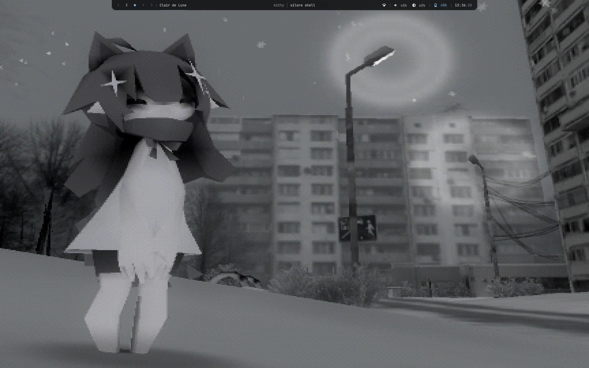
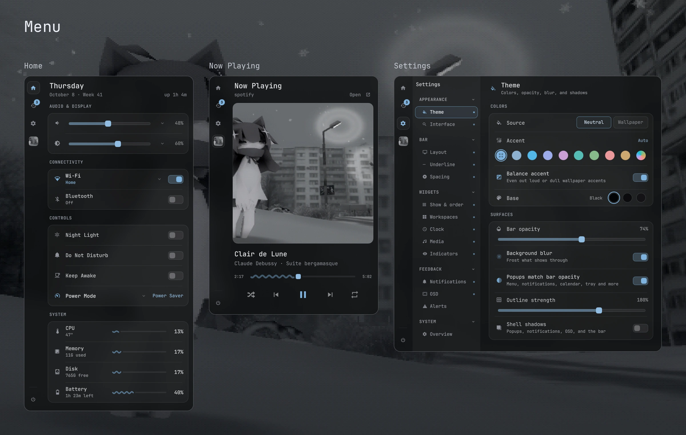
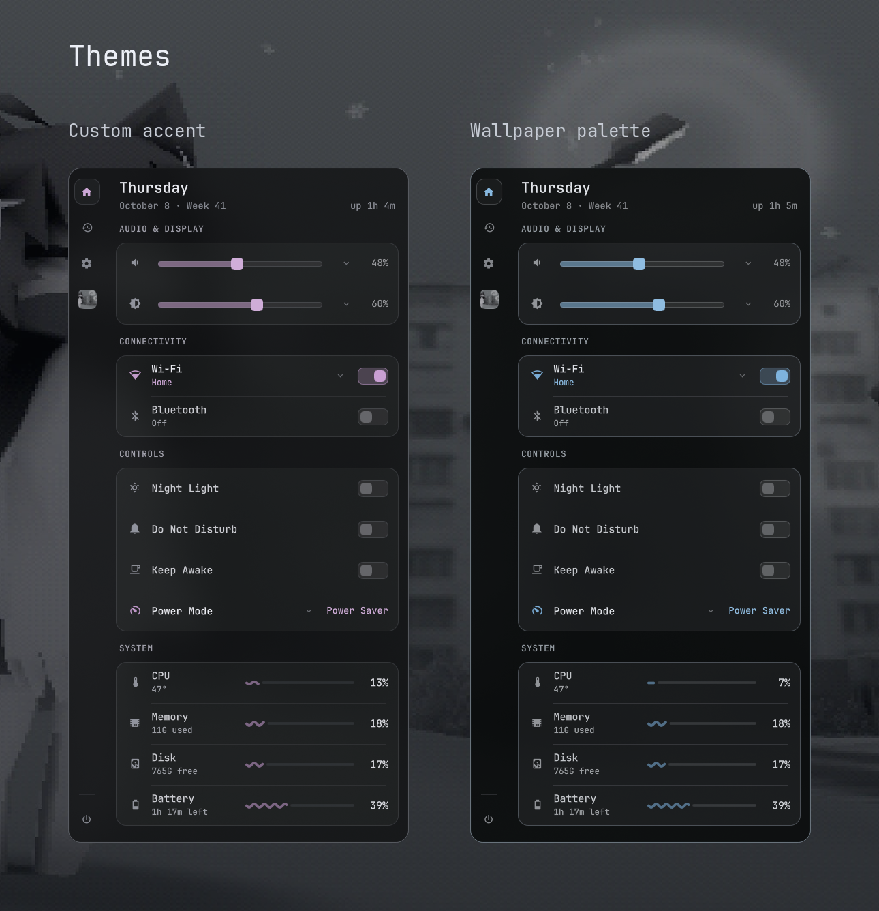

<p align="center">
  <picture>
    <source media="(prefers-color-scheme: light)" srcset="assets/banner-light.svg"/>
    
  </picture>
</p>

<p align="center">
  <a href="https://github.com/s3rven/silere-shell/releases"></a>
  <a href="https://github.com/s3rven/silere-shell/actions/workflows/validate.yml"></a>
  <a href="#performance"></a>
  <a href="LICENSE"></a>
  <a href="https://quickshell.org/"></a>
  
</p>

<p align="center">
  A desktop shell for <b>Hyprland</b> and <b>niri</b>. It replaces your bar, notification
  daemon, OSD and tray with one <b>Quickshell</b> process that idles under 1% CPU.
</p>

<p align="center">
  
</p>

## What you get

- A bar you arrange yourself: workspaces with app icons, window title, media, network,
  volume, brightness, battery, tray, clock and more.
- A menu one click away, with volume per output and per app, brightness, Wi-Fi,
  Bluetooth, power mode, night light, Keep Awake and Do Not Disturb.
- Notifications with actions, inline replies and a searchable history. Volume and
  brightness scripts written for dunst or mako replace their card instead of stacking.
- Now Playing with cover art, seeking, player switching and an optional visualizer.
- An OSD for volume, brightness and battery warnings, floating or built into the bar.
- Colours from your wallpaper through Matugen, or an accent you pick yourself.
- Signed updates from the menu, and `silere update --rollback` if you don't like one.

<p align="center">
  
</p>

## Lightweight

Silere runs as one process, and Quickshell is its only required dependency. Tools like
cava, Matugen or brightnessctl are optional. Without one, only its feature is unavailable,
and Settings lists what is missing and what it adds.

The visualizer, network speed readings, clock seconds and underline effects start
switched off. System readings and animations pause when the session goes idle.

## Install

### 1. Install the prerequisites

You need a **Hyprland or niri session**, **git**, and **Quickshell 0.3.1 or newer**,
built against **at least Qt 6.9**. The one-line installer below also needs **curl**.

On Arch Linux:

```bash
sudo pacman -S --needed quickshell git curl
```

For other distributions, follow [Quickshell's install guide](https://quickshell.org/docs/v0.3.1/guide/install-setup/).

### 2. Install Silere

```bash
curl -fsSL https://raw.githubusercontent.com/s3rven/silere-shell/main/scripts/install.sh | bash
```

The installer offers fonts, autostart, the menu shortcut and a `silere` command.
It asks before editing your compositor config and backs up files it changes.
The default install is `~/.config/silere-shell`.

[Install from a clone, preview the changes, or choose another path](docs/install.md).

### 3. Start the shell

Stop your previous bar and notification daemon, then run:

```bash
silere run
```

If you skipped the command link, use `~/.config/silere-shell/scripts/silere run`.
Keep your launcher, wallpaper tools and lock screen; choose the lock command in
**Settings › Appearance › Interface**.

To remove it, `silere uninstall` clears the autostart, shortcut and other integrations,
and keeps your settings in case you come back.

## Use

| To open | Do this |
|---|---|
| Menu | Click the active workspace |
| Quick actions | Right-click the active workspace |
| Calendar | Click the clock |
| Now Playing | Right-click the media widget |

The installer offers **Super + /** as a menu shortcut on Hyprland. Press **Escape**
to step back or close a popup. [All controls and shortcuts](docs/usage.md).

### Make it yours

Open **Settings** to change the bar layout, colours, font, scale and motion. Changes
apply immediately.

<p align="center">
  
</p>

<details>
<summary>Config files, scripting and updates</summary>

Preferences are saved to `~/.config/silere-shell/settings.json`, or your
`$XDG_CONFIG_HOME` path. Only changes from the defaults are stored.
To reset the file, replace its contents with `{ "__version": 1 }`.
[The scripting guide](docs/scripting.md) lists IPC calls and event hooks.

**Settings › System › Overview** holds updates, diagnostics and restore defaults.
Silere verifies release signatures and asks before installing from the menu.
[Updating and rolling back](docs/usage.md#updates).

</details>

## Performance

On the reference machine, release **1.4.2** measured about **84 MB PSS** with the bar
and **95 MB** after opening the menu, with idle CPU under **1% of one core**.
Your hardware, fonts and enabled features affect the result.
[Measurements and benchmarking](docs/performance.md).

## Help

Start with `silere doctor` to check your setup. `silere log --follow` shows the log,
and `silere restart` restarts the shell.

[Common problems](docs/troubleshooting.md) · [Ask a question](https://github.com/s3rven/silere-shell/discussions) · [Report a bug](https://github.com/s3rven/silere-shell/issues/new?template=bug_report.yml) · [Installation guide](docs/install.md) · [Performance details](docs/performance.md)

## Contributing

Fixes, ideas and documentation changes are welcome. See [CONTRIBUTING.md](CONTRIBUTING.md)
and [the code guide](docs/forking.md).

### On AI assistance

I use AI tools while building Silere. I review the changes and use the shell on my own desktop.
AI-assisted contributions are welcome too.

[MIT](LICENSE) © s3rven
