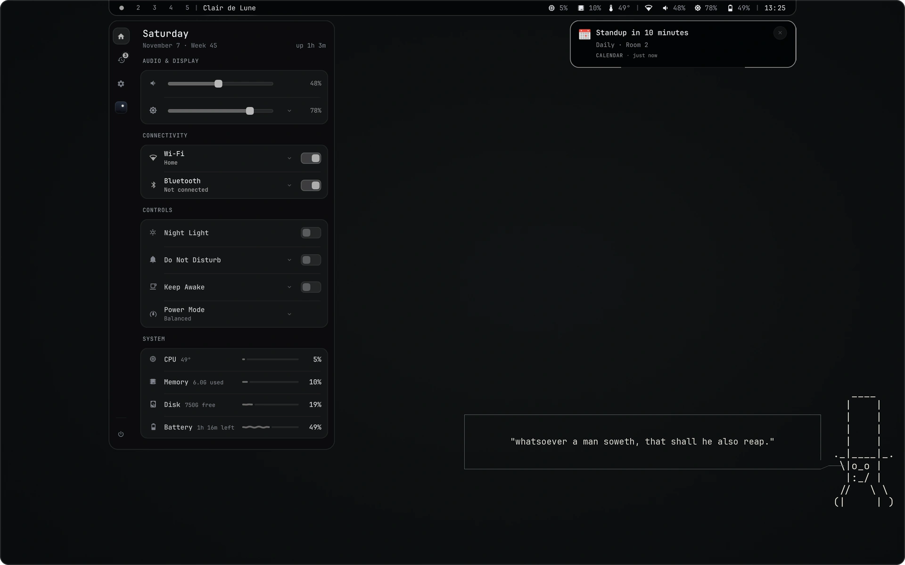
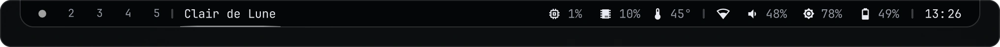
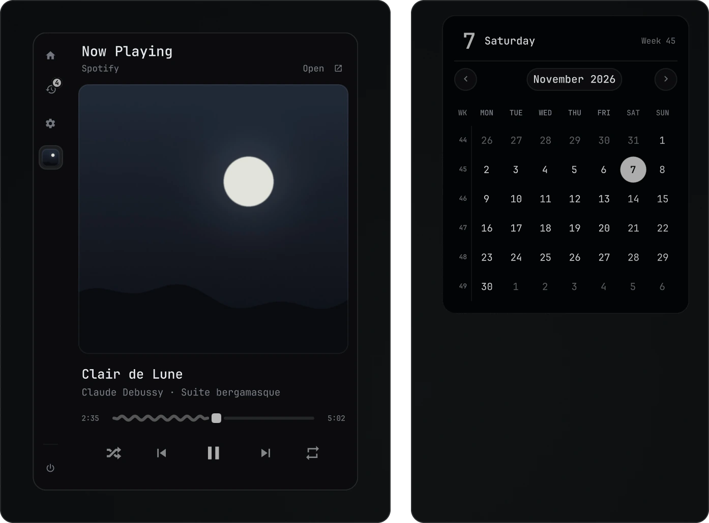
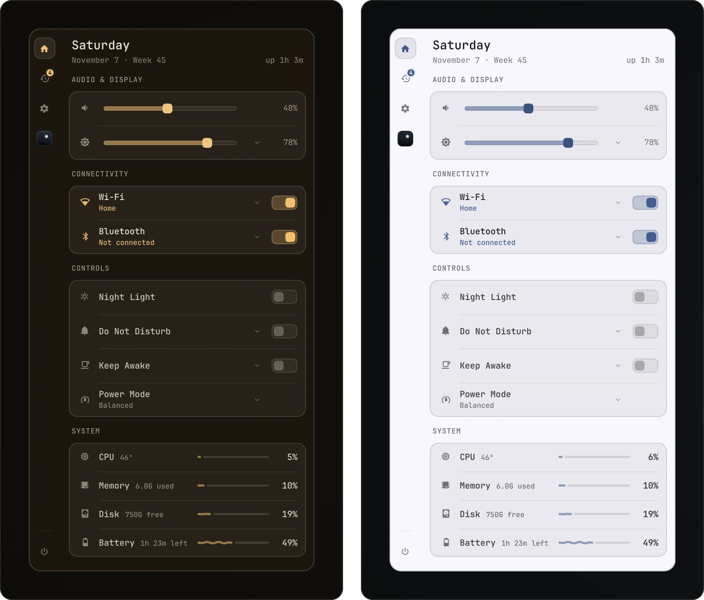
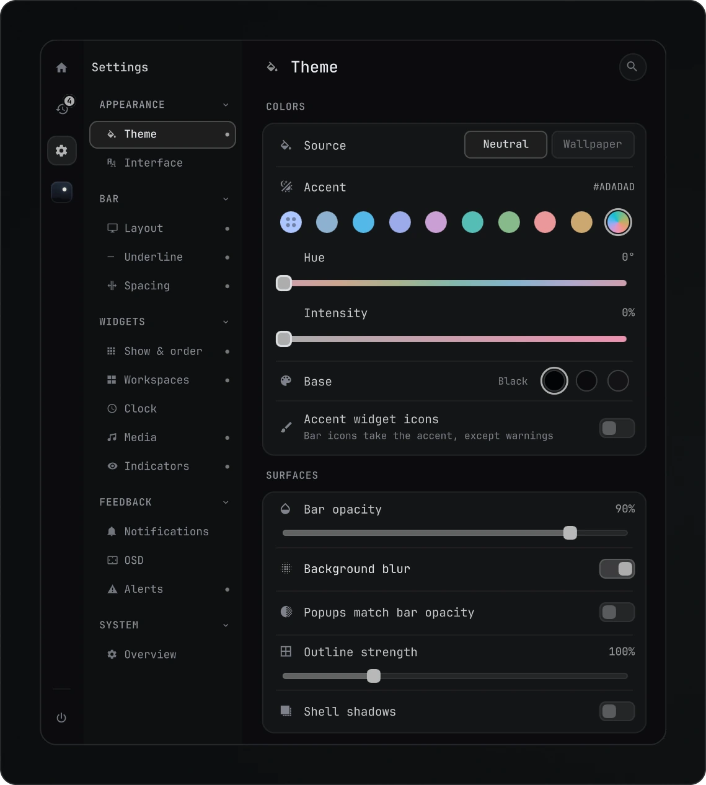

<p align="center">
  <picture>
    <source media="(prefers-color-scheme: light)" srcset="assets/banner-light.svg"/>
    
  </picture>
</p>

<p align="center">
  <a href="https://github.com/s3rven/silere-shell/releases"></a>
  <a href="https://github.com/s3rven/silere-shell/actions/workflows/validate.yml"></a>
  <a href="LICENSE"></a>
</p>

<p align="center">
  A desktop shell for <b>Hyprland</b> and <b>niri</b>, built on
  <a href="https://quickshell.org/">Quickshell</a>.
</p>

<p align="center">
  <a href="#getting-started">Get started</a> ·
  <a href="#a-closer-look">Screenshots</a> ·
  <a href="#getting-around">Controls</a> ·
  <a href="docs/README.md">Documentation</a> ·
  <a href="#when-somethings-wrong">Help</a>
</p>

<p align="center">
  
</p>

Silere is the bar, notifications, tray and quick settings I use on my own desktop.
It runs in one process and can take the place of Waybar and a notification daemon
such as mako or dunst.

You keep your compositor setup and dotfiles, and choose your own launcher, wallpaper
tool and lock screen.

## What's included

| Feature | What you get |
|---|---|
| Bar | Workspaces with app icons, window title, media, system readings, tray and clock. Choose the widgets and their order. |
| Quick settings | Output, microphone and per-app volume; brightness; Wi-Fi, Bluetooth and VPN; power mode, Night Light and Keep Awake; battery health and charge limit. |
| Notifications | Actions, inline replies, conversation grouping, searchable history, app muting and Do Not Disturb. |
| Media | Album art, seeking, player switching and an optional Cava visualizer. |
| On-screen display | Volume, brightness, power mode changes and battery warnings, floating or inside the bar. |
| Appearance | Wallpaper colours through Matugen, dark and light modes, a custom accent and adjustable interface size. |
| Updates | Signed releases from the menu, validation before installation and rollback to the previous version. |

## A closer look

<p align="center">
  
  <br/><sub>The bar: workspaces, what's playing, system readings, network, volume, brightness, battery and the clock.</sub>
</p>

<p align="center">
  
  <br/><sub>Now Playing with cover art and seeking, and the calendar with week numbers.</sub>
</p>

<p align="center">
  
  <br/><sub>Colours from your wallpaper through Matugen, and light mode.</sub>
</p>

<p align="center">
  
  <br/><sub>Settings apply as you change them, and Ctrl+F finds any option.</sub>
</p>

## Getting started

You'll need a Linux desktop running **Hyprland or niri**, and **Quickshell 0.3.1 or newer**
built against **at least Qt 6.10**. On Arch Linux:

```bash
sudo pacman -S --needed quickshell git curl ttf-jetbrains-mono-nerd
```

For other distributions, see [Quickshell's installation guide](https://quickshell.org/docs/v0.3.1/guide/install-setup/).
Icons need a Nerd Font; the installer can download JetBrainsMono Nerd Font, or you
can [install it before the preview](docs/install.md#fonts).

On Hyprland 0.57 or newer, use Quickshell 0.3.2 or newer for
[named and special workspaces](docs/troubleshooting.md#special-or-named-workspaces-misbehave-after-a-hyprland-update).

### Try it first

From a Wayland session, open the shell in a window. The preview also needs
`dbus-run-session` and `setsid`:

```bash
git clone --depth 1 https://github.com/s3rven/silere-shell
cd silere-shell
bash scripts/silere try
```

The preview uses a separate session and temporary settings. Close the window to end
it and remove its temporary files. Audio, network and Bluetooth controls use your
real devices.

**Alt + /** opens the preview's menu. Once installed, you can open another preview
with `silere try`.

### Install

Run the installer as your normal user. Before accepting its offer to start Silere,
stop your current bar and notification daemon:

```bash
curl -fsSL https://raw.githubusercontent.com/s3rven/silere-shell/main/scripts/install.sh | bash
```

Or, from inside the clone used for the preview:

```bash
bash scripts/install.sh
```

The installer checks QML dependencies and offers autostart and a `silere` command
in `~/.local/bin`. It asks before editing your compositor config and backs up what
it changes. The default install directory is `~/.config/silere-shell`.

If the installer hasn't started it, run `silere run` inside your Hyprland or niri session,
or `~/.config/silere-shell/scripts/silere run` while `silere` isn't on your `PATH`.

See the [installation guide](docs/install.md) for a dry run, custom directories,
unattended setup and crash recovery. `silere uninstall` removes the installer's
integrations and keeps your settings.

## Getting around

| Panel | How to open it |
|---|---|
| Menu | Click the active workspace |
| Quick actions | Right-click the active workspace |
| Calendar | Click the clock |
| Now Playing | Right-click the media widget |

The installer offers **Super + /** as a menu shortcut on Hyprland. On niri, add the
line it prints to your existing `binds` block.

Use Tab and Shift+Tab to move between controls, Enter or Space to activate them,
and the arrow keys for lists and sliders. Escape steps back, then closes the panel.
Type in an open dropdown to find an option.

The [usage guide](docs/usage.md) covers the other clicks, shortcuts and scroll
actions. For a menu keybind of your own, use `silere ipc menu toggle`;
the [scripting guide](docs/scripting.md) lists IPC commands and event hooks.

## Settings

Open **Settings** in the menu to change the bar, colours, interface size, devices and
behaviour. Most changes apply immediately. **Ctrl+F** finds an option by name or feature,
and a dot in the sidebar marks pages you've changed. Pick your own accent, or use your
wallpaper's colours through [Matugen](docs/install.md#matugen), which the installer
offers to set up.

Only values that differ from the defaults are saved, in `~/.config/silere-shell/settings.json`,
or under `$XDG_CONFIG_HOME` when you've set an absolute one. Restore defaults from
**Settings › System › Overview**, or preview a reset with `silere reset` when the menu
won't open. See [settings and resets](docs/usage.md#settings) for the details.

## Other desktop tools

These are the tools I use alongside Silere. None are required to start the shell.

| For | I use |
|---|---|
| Launcher, clipboard history, file search and window switching | [Vicinae](https://github.com/vicinaehq/vicinae) |
| Wallpaper | [awww](https://codeberg.org/LGFae/awww) |
| Colours from the wallpaper | [Matugen](https://github.com/InioX/matugen) |
| Lock screen and idle | [hyprlock](https://github.com/hyprwm/hyprlock) and [hypridle](https://github.com/hyprwm/hypridle) |
| Night light | [hyprsunset](https://github.com/hyprwm/hyprsunset) on Hyprland; [wlsunset](docs/troubleshooting.md#night-light-is-unavailable-on-niri) on niri |
| Screenshots | [grim](https://gitlab.freedesktop.org/emersion/grim), [slurp](https://github.com/emersion/slurp) and [Satty](https://github.com/gabm/Satty) |
| Audio visualizer | [Cava](https://github.com/karlstav/cava) |

Silere detects helpers for its controls and lists missing ones in Settings. See the
[optional tools table](docs/install.md#optional-tools) for packages that enable
brightness, audio, VPN and other features.

## Useful commands

| Command | What it does |
|---|---|
| `silere run` | Start the shell |
| `silere stop` | Stop the shell, including its optional user service |
| `silere restart` | Restart the shell |
| `silere status` | Show the running checkout and update state |
| `silere doctor` | Check the setup without changing it |
| `silere log --follow` | Follow the running shell's log |
| `silere update` | Check for a signed release |
| `silere update --apply` | Validate and install the release |
| `silere update --rollback` | Restore the version an update replaced |
| `silere reset` | Preview a reset of settings, local edits and caches |

Run `silere help` for all commands. Releases can also be installed from
**Settings › System › Overview**. See [updates and recovery](docs/updates.md)
for automatic checks, local edits and rollback.

## Under the hood

Animations and system readings pause when the session goes idle. The visualizer,
network speed, clock seconds and underline effects start switched off.

The [1.6.0 measurements](docs/perf-history.md) below used the reference laptop with
the session locked, the visualizer off and [service tuning](docs/performance.md#optional-tuning):

| Measurement | Result |
|---|---|
| Memory after startup | 78 MB PSS |
| Memory after one menu open and close | 86 MB PSS |
| Average idle CPU | 0.2% of one core |

These figures depend on the hardware, fonts, enabled widgets and tuning. The
[performance guide](docs/performance.md) explains PSS, records the test conditions
and shows how to measure your own setup.

The test suite covers service logic, keyboard and pointer input, live settings,
layout fit and display scaling. Integration tests use private compositor and
PipeWire sessions; fault tests exercise hung tools and malformed notifications,
media metadata and tray items. The [testing guide](docs/testing.md) describes the
checks, CI coverage and known limits.

## When something's wrong

Start with `silere doctor` and the [troubleshooting guide](docs/troubleshooting.md).
For a bug report, include the output of `silere version`, the steps to reproduce
it and the relevant errors. [Reporting a problem](docs/troubleshooting.md#reporting-a-problem)
explains where to find logs, including when the shell won't start.

[Ask a question](https://github.com/s3rven/silere-shell/discussions) · [Report a bug](https://github.com/s3rven/silere-shell/issues/new?template=bug_report.yml)

## Contributing

Fixes, ideas and documentation changes are welcome. Read the
[contributing guide](CONTRIBUTING.md) for checks and commit conventions, or the
[code guide](docs/forking.md) for the project layout.

### On AI assistance

I use AI tools while building Silere. I review the changes and use the shell on my own desktop.
AI-assisted contributions are welcome too.

[MIT](LICENSE) © s3rven
