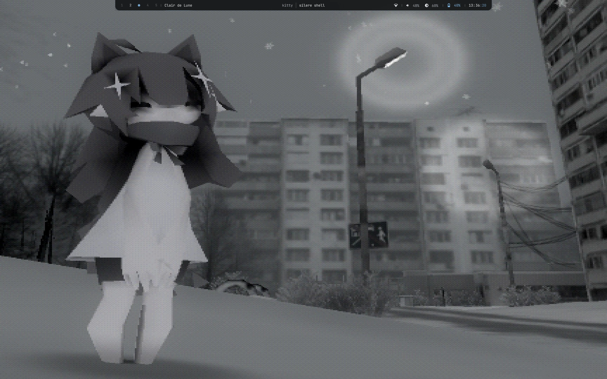
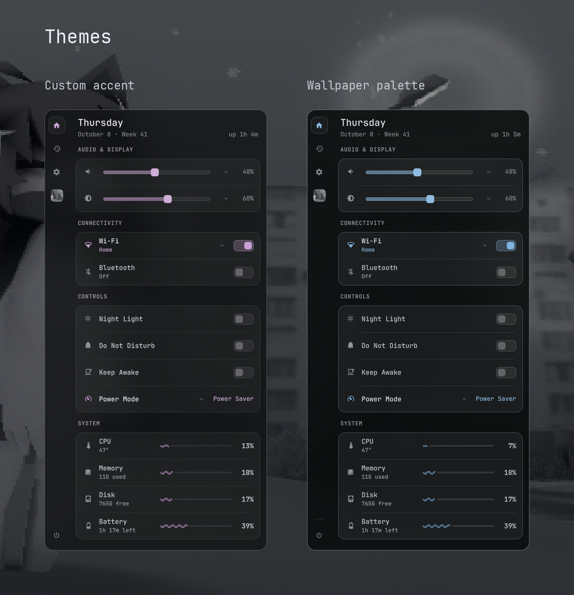

<p align="center">
  <picture>
    <source media="(prefers-color-scheme: light)" srcset="assets/banner-light.svg"/>
    
  </picture>
</p>

<p align="center">
  <a href="https://github.com/s3rven/silere-shell/releases"></a>
  <a href="https://github.com/s3rven/silere-shell/actions/workflows/validate.yml"></a>
  <a href="LICENSE"></a>
</p>

<p align="center">
  A desktop shell for <b>Hyprland</b> and <b>niri</b>, built on
  <a href="https://quickshell.org/">Quickshell</a>.
</p>

<p align="center">
  
</p>

Silere is the bar, notifications, OSD, tray and quick settings I use every day, in one
process. It replaces waybar, mako or dunst and the small scripts around them. Your
compositor config, launcher, wallpaper tool and lock screen stay as they are.

## Install

You need a Hyprland or niri session, and Quickshell 0.3.1 or newer built against at least
Qt 6.9. On Arch:

```bash
sudo pacman -S --needed quickshell git curl
curl -fsSL https://raw.githubusercontent.com/s3rven/silere-shell/main/scripts/install.sh | bash
```

Stop your old bar and notification daemon, then start the shell:

```bash
silere run
```

The installer offers fonts, autostart, a menu shortcut and the `silere` command. It asks
before editing your compositor config and backs up what it changes. `silere uninstall`
removes all of that and keeps your settings.

For other distributions, start with [Quickshell's install guide](https://quickshell.org/docs/v0.3.1/guide/install-setup/).
[docs/install.md](docs/install.md) covers installing from a clone, previewing the changes
and choosing another path.

## What's in it

| | |
|---|---|
| **Bar** | Workspaces with app icons, window title, media, network, volume, brightness, battery, tray, clock and a system monitor. You choose what shows and in what order. |
| **Menu** | Volume per output and per app, brightness, Wi-Fi, Bluetooth, VPN, power mode, night light, Keep Awake and Do Not Disturb. |
| **Notifications** | Actions, inline replies and searchable history. A conversation stays on one card, and you can mute any app. Volume scripts written for dunst or mako replace their card instead of stacking. |
| **Now Playing** | Cover art, seeking, player switching and an optional visualizer. |
| **OSD** | Volume, brightness and battery warnings, floating or built into the bar. |
| **Colours** | Taken from your wallpaper through Matugen, or an accent you pick. |
| **Updates** | Signed releases, installed from the menu. `silere update --rollback` puts the last version back. |

<p align="center">
  
</p>

## What it leaves to you

Silere doesn't include an app launcher, wallpaper picker, lock screen, clipboard manager
or AI assistant. It calls the tools you already use, and Settings is where you point it
at them. It won't set up your system or replace your dotfiles either.

If you'd rather have one project run the whole desktop, look at
[end-4's dots-hyprland](https://github.com/end-4/dots-hyprland) or
[Dux Shell](https://duxlabs.dev/).

## Getting around

| To open | Do this |
|---|---|
| Menu | Click the active workspace, or Super + / if you took the shortcut |
| Quick actions | Right-click the active workspace |
| Calendar | Click the clock |
| Now Playing | Right-click the media widget |

Escape steps back one level, then closes. Tab, Shift+Tab, Enter and the arrow keys work
through the controls, and an open dropdown takes typing to find a row.
[docs/usage.md](docs/usage.md) lists the rest.

## Settings

Everything is in the menu under **Settings** and applies as you change it. A page you've
changed shows a dot in the sidebar, and **Settings › System › Overview** restores the
defaults.

<p align="center">
  
</p>

Preferences live in `~/.config/silere-shell/settings.json`, which only stores what differs
from the defaults. To reset all of it, replace the contents with `{ "__version": 2 }`.
[docs/scripting.md](docs/scripting.md) covers IPC calls and event hooks.

## Resource use

Quickshell is the only hard dependency. cava, Matugen, brightnessctl and the like are
optional: without one, its feature is off, and Settings tells you what's missing.

On my laptop a session settles around 130 MB of memory, and at idle Silere uses about 0.2%
of one core and writes nothing to disk. The visualizer, network speed, clock seconds and
underline effects start switched off, and animations and system readings stop when the
session goes idle. Your numbers will depend on your hardware, fonts and which widgets
you turn on. [docs/performance.md](docs/performance.md) has the measurements and how to
take your own.

## When something's wrong

`silere doctor` checks your setup, `silere log --follow` shows the log and `silere restart`
restarts the shell. [Common problems](docs/troubleshooting.md) covers the usual fixes.

[Ask a question](https://github.com/s3rven/silere-shell/discussions) · [Report a bug](https://github.com/s3rven/silere-shell/issues/new?template=bug_report.yml)

## Contributing

Fixes, ideas and documentation changes are welcome. See [CONTRIBUTING.md](CONTRIBUTING.md)
and [the code guide](docs/forking.md).

### On AI assistance

I use AI tools while building Silere. I review the changes and use the shell on my own desktop.
AI-assisted contributions are welcome too.

[MIT](LICENSE) © s3rven
